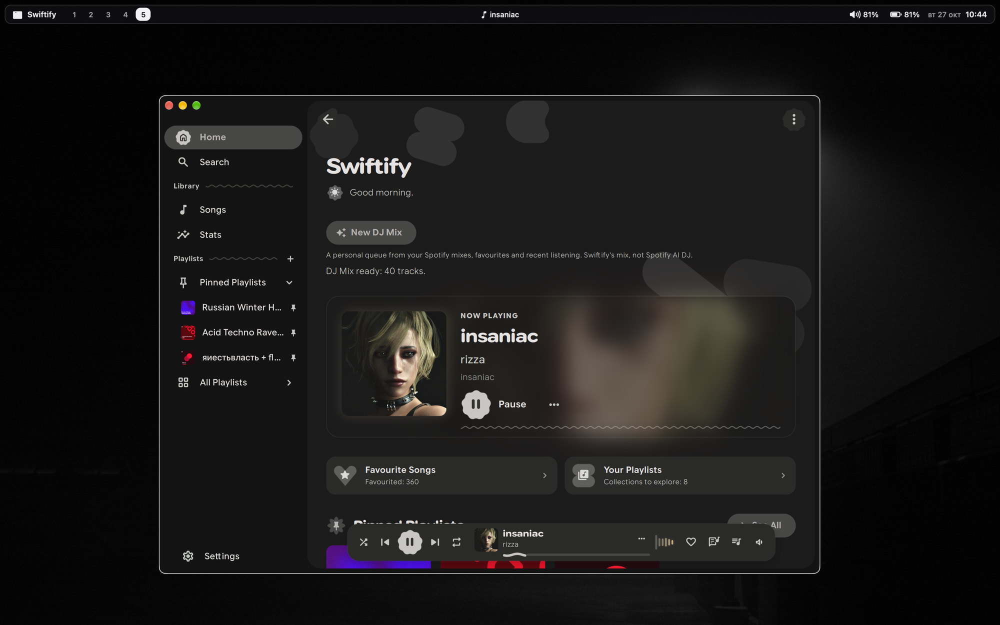
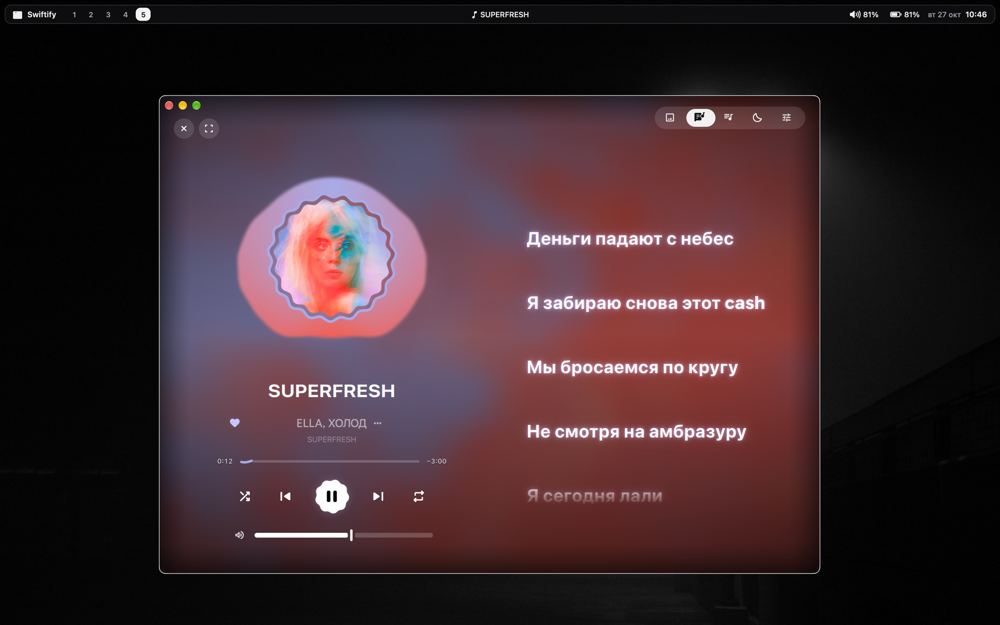
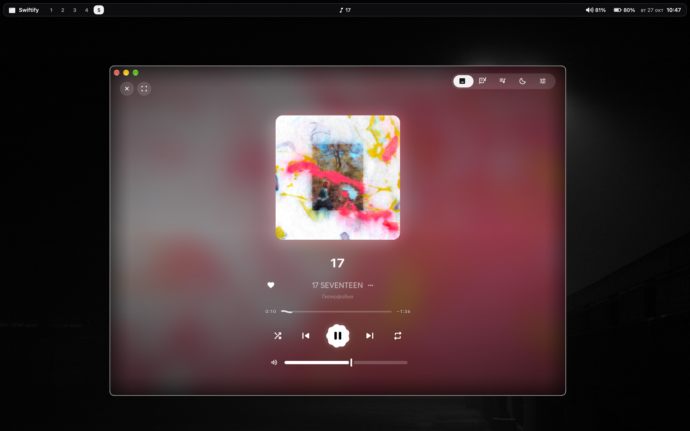

# swiftify

a spotify desktop player, the way i want to use it.

[download](https://github.com/ceoweb20/swiftify/releases/latest) · [first launch](#first-launch) · [build from source](#build-from-source) · [upstream](https://github.com/swiftify-org/swiftify)

this is my personal fork of [swiftify](https://github.com/swiftify-org/swiftify), not a separate project built from scratch. i keep what i use, add what i miss, and remove what feels like clutter to me. compared with the original, this is the version i find more comfortable to use. it follows my preferences, not a plan to be the right client for everyone.

the foundation is still c++ and qt quick, with a rust core built around [librespot](https://github.com/librespot-org/librespot). no electron or bundled web browser.



<table>
  <tr>
    <td width="50%"></td>
    <td width="50%"></td>
  </tr>
  <tr>
    <td><sub>synced lyrics and a cover-colored background</sub></td>
    <td><sub>just the artwork, the track and the controls</sub></td>
  </tr>
</table>

## what's different here

- **less clutter.** local-file management, playlist-link collections and the extra librespot connect-device settings are removed. fullscreen visualizers are controlled inside the fullscreen player, without a second switch in settings.
- **cover-driven themes.** the whole interface can follow the current artwork. there are also light and dark presets, including aurora and desert bloom, plus optional matugen integration.
- **a personal dj mix.** one button builds a queue from your spotify mixes, favourites, recent listening and top tracks by those artists. up to 40 tracks, no duplicate tracks, and different artists next to each other where possible.
- **librespot first, soloist when needed.** an audio-key refusal can switch playback to spotify's official soloist client. installation and api-key setup live in settings.
- **english and russian.** live language switching, translated dialogs and errors, and dates and numbers that follow the selected language.
- **less login friction.** encrypted spotify logins with automatic vault unlock on macos and windows. existing vaults need their old password once to migrate.
- **installers and updates.** macos disk images, a windows setup executable, and signed in-app update packages.

the rest of the player is here too: search, saved songs, playlists, pinned playlists, synced lyrics, an equalizer, a sleep timer, media keys, optional discord activity and listening stats.

## install

get this fork from **[github releases](https://github.com/ceoweb20/swiftify/releases/latest)**. upstream downloads are a different build.

| platform | download | installation |
| --- | --- | --- |
| macos · apple silicon | `macos-aarch64.dmg` | open the image and drag the app to applications |
| macos · intel | `macos-x86_64.dmg` | same, but soloist is unavailable on intel macs |
| windows · x64 | `windows-x86_64-setup.exe` | run setup; it adds shortcuts and an uninstaller without requiring administrator access |
| linux · x64 | `linux-x86_64.zip` | extract it and run `./Swiftify/bin/swiftify` |

the filenames also include the version number. screenshots show the current code; a published release can lag behind while builds finish.

linux packages bundle qt, but still need the host's audio and system libraries, including alsa, pulseaudio or pipewire-pulse, glib and dbus. macos builds are not notarized, and windows builds are not authenticode-signed, so the os may ask you to approve the first launch.

the other zip files are portable builds and update payloads. `.json` and `.sig` files are update metadata, not installers. keep a portable installation's files together.

## first launch

you need a spotify premium account for librespot playback, and a client id from your own spotify developer app for the library, playlists and search.

1. open the [spotify developer dashboard](https://developer.spotify.com/dashboard) and create an app. select the web api if asked.
2. add this exact redirect uri in the app's settings:

   ```text
   http://127.0.0.1:8898/login
   ```

3. copy the client id into swiftify and choose **connect library**. the client secret is not needed.
4. choose **connect playback** and finish the spotify login in your browser.
5. pick something to play.

use the same spotify account for the library and playback if you want personalized mixes to match. the spotify api can restrict some playlists or library operations; swiftify cannot grant permissions that spotify does not provide.

### if librespot cannot play

some accounts, particularly newer ones, are refused the audio keys librespot needs. swiftify detects that refusal and switches to **[spotify soloist](https://developer.spotify.com/documentation/soloist)**. an ordinary network error or an unavailable track does not trigger the switch.

to set it up:

1. open **settings → account → spotify soloist** and choose **install soloist**.
2. create your own key in the [soloist dashboard](https://developer.spotify.com/dashboard/soloist).
3. paste the key into swiftify and press enter.
4. once, open the official spotify app on the same network and select the device named **swiftify**. this pairs soloist with your account.
5. return to swiftify and press play.

pairing is saved. you do not need to repeat it on every launch or open spotify every time you use swiftify. each user needs their own soloist key; none is included with this app.

soloist is downloaded directly from spotify, not bundled or redistributed. official builds exist for linux x86_64/arm, apple silicon macos and x86_64 windows. builds expire after 90 days; swiftify refreshes its managed download after 80 days and when an expired build exits.

manual installations also work: put the executable on your path, use `SWIFTIFY_SOLOIST` to point to it, or use [the shell installer](tools/install-soloist.sh) / [the powershell installer](tools/install-soloist.ps1). a key can also be supplied through `SOLOIST_API_KEY` or the `soloist/api-key` file in the system configuration directory.

## a few things worth knowing

### dj mix is not spotify ai dj

the button on home assembles a local queue using the music available to your account. it removes duplicate and unplayable tracks, avoids immediately replaying the current song, and tries to space artists apart. **new dj mix** builds another queue.

it is not spotify's ai dj algorithm, has no announcer, and does not create a playlist on your account. spotify does not expose an official api for controlling ai dj. if personalized playlists are unavailable, swiftify falls back to your library and listening history. a failed or cancelled request leaves your existing queue alone.

### themes and fullscreen playback

choose **settings → appearance → colours → cover colors** to let the interface follow the playing cover. palettes are cached and calculated off the ui thread; they fade between tracks and fall back to the default palette when artwork is missing.

matugen is optional. it generates a material-style palette from an image, usually your wallpaper. swiftify can follow its json output; you do not need it to use the built-in themes.

the fullscreen player's sound panel has its own visualizer switch. the global visualizer setting still takes priority.

### soloist audio and lossless

soloist supports lossless playback up to **24-bit / 44.1 khz** with premium, according to [spotify's documentation](https://github.com/spotify/soloist). availability also depends on the account and region. its current api cannot set or verify the delivered quality, so swiftify does not pretend that a local switch can enable it.

the lossless information section appears when the soloist backend is selected. the 96/160/320 kbit/s setting controls librespot, not soloist.

on macos and windows, soloist outputs directly to the system, outside the rust audio pipeline. rust-side equalizer, spectrum analysis, tempo and pitch processing do not apply to that output. linux with pipewire can route soloist through swiftify for the equalizer and visualizers; `SWIFTIFY_SOLOIST_ROUTE=off` disables that route. soloist playback also does not use swiftify's librespot crossfade.

### saved logins

spotify logins stay in an encrypted vault outside the application directory. macos can remember its unlock password in keychain; windows uses user-scoped dpapi encryption. new installations create a random vault password automatically.

if you already have a password-protected vault, enter its old password **once** to migrate. subsequent launches unlock automatically when secure storage is available. linux keeps the manual password flow. a locked keychain, denied access or a changed macos signing identity can require manual unlock again.

reinstalling the app does not require deleting your data. see [vault storage and recovery](docs/credential-vault.md) before moving or resetting the credential files.

### discord and listening stats

discord activity is optional and off by default. create an app in the [discord developer portal](https://discord.com/developers/applications), then paste its application id into **settings → account → discord rich presence**. no bot token is needed. discord's desktop app and activity-sharing permission must be enabled. this is rich presence, not spotify's linked-account activity or listen along.

the stats page can use local listening history or a public [stats.fm](https://stats.fm) profile. local history stays on your computer and can be exported as csv. its collection can be disabled in settings.

### updates and restarting

release builds can check for updates and install them while nothing is playing. both automatic checking and installation can be disabled under **settings → about → updates**. system-package installations should use their package manager instead.

the player remembers the last track, position and queue, but restores them **paused**. opening the app should not start music by itself.

## build from source

you need git, a c++20 compiler, **qt 6.10 or newer**, qcoro for qt 6, cmake 3.24+, ninja and a current stable rust toolchain from [rustup](https://rustup.rs).

qt needs the base, declarative, shader tools and websockets modules. linux also needs the pulse/alsa and openssl development packages. the first configure downloads corrosion and the interface/icon fonts, with pinned versions or hashes.

```sh
git clone https://github.com/ceoweb20/swiftify.git
cd swiftify
```

<details>
<summary>macos</summary>

install apple's command line tools and the dependencies through homebrew. install rust separately if it is not already available.

```sh
xcode-select --install
brew install cmake ninja qtbase qtdeclarative qtshadertools qtwebsockets qcoro6

cmake -S . -B build -G Ninja -DCMAKE_BUILD_TYPE=Release -DBUILD_TESTING=OFF
cmake --build build --parallel
open build/swiftify.app
```

this is a local, ad-hoc-signed build. for a self-contained package with qt bundled, use [the macos release script](tools/build-macos-portable.sh) with `QT_ROOT_DIR` pointing to your qt kit. it produces both a disk image and the updater zip.

</details>

<details>
<summary>linux</summary>

for arch-based systems:

```sh
sudo pacman -S --needed git cmake ninja rust pkgconf \
  qt6-base qt6-declarative qt6-shadertools qt6-wayland qt6-websockets \
  qcoro libpulse alsa-lib openssl

cmake -S . -B build -G Ninja -DCMAKE_BUILD_TYPE=Release \
  -DBUILD_TESTING=OFF -DCMAKE_INSTALL_PREFIX="$HOME/.local"
cmake --build build --parallel
cmake --install build
```

make sure `~/.local/bin` is on your path. a [pkgbuild](packaging/arch/PKGBUILD) is also included if you prefer a package-managed installation.

on debian or ubuntu, the [debian build script](tools/build-debian.sh) can install distro dependencies:

```sh
./tools/build-debian.sh --install-deps
```

install rust, cmake and ninja first. the script has compatibility patches for older system qt versions and modifies the checkout; a qt 6.10+ build remains the preferred configuration.

linux integration includes mpris/media keys, the system tray and pausing before sleep. `-DSWIFTIFY_DESKTOP_INTEGRATION=OFF` disables the pulse/desktop integration pieces for development builds.

</details>

<details>
<summary>windows</summary>

install git, cmake, ninja, rust and a qt kit with shader tools and websockets. the recommended combination is **visual studio 2022** with the desktop c++ workload and **qt 6.10.3 msvc2022_64**, matching the release workflow.

from powershell in the repository root:

```powershell
.\tools\build-windows.ps1 -QtPath 'C:\Qt\6.10.3\msvc2022_64'
```

the script builds dependencies, installs the app and deploys the required qt/runtime libraries. its default destination is `%LOCALAPPDATA%\Programs\Swiftify`:

```powershell
& "$env:LOCALAPPDATA\Programs\Swiftify\bin\swiftify.exe"
```

matching mingw kits are supported through `-MingwPath`, but older mingw headers lack windows media controls. use msvc if you want the complete feature set. if powershell blocks the script, a process-local override is available:

```powershell
powershell -NoProfile -ExecutionPolicy Bypass -File .\tools\build-windows.ps1
```

the setup executable is built with inno setup 6 through [the installer packager](tools/package-installer.py). the github actions workflow handles that step for releases.

</details>

### tests

for a manual cmake build, configure with testing enabled, then build and run:

```sh
cmake -S . -B build -DBUILD_TESTING=ON
cmake --build build --parallel
ctest --test-dir build --output-on-failure
python3 tests/check_translations.py .
python3 tests/check_update_tools.py
```

## command line

only one instance runs at a time. launching another copy passes the command to the running player, which makes these useful for desktop shortcuts:

| option | action |
| --- | --- |
| `--immersive` | open the fullscreen player |
| `--play-pause` | toggle playback |
| `--next` | next track |
| `--previous` | previous track |
| `--stats` | open listening stats |

## problems and project notes

- **login does not return to the app:** check the redirect uri above and make sure port `8898` is not occupied.
- **spotify refuses the audio key:** configure soloist rather than repeatedly reconnecting librespot.
- **soloist is not listed in spotify:** check that both devices are on the same network and that a firewall is not blocking discovery. pairing from the desktop app on the same computer can help.
- **the vault asks again after migration:** secure storage was unavailable or access was denied. on macos, changing the build's signing identity can also break keychain trust.
- **personalized playlists are missing:** that feed uses an internal spotify interface and can change or be unavailable for an account. the ordinary library and dj mix's library fallback do not require it.

report fork-specific problems in [this repository's issues](https://github.com/ceoweb20/swiftify/issues), with your os, app version and playback backend. leave api keys and tokens out of logs and screenshots.

this is a personal fork, so features and fixes follow what i use. if you want to propose a larger change, open an issue before writing it. upstream remains the source of the original player and most of its interface; please don't send fork-specific bug reports there.

thanks to [the original swiftify project](https://github.com/swiftify-org/swiftify), [librespot](https://github.com/librespot-org/librespot), [spotify soloist](https://developer.spotify.com/documentation/soloist) and the libraries behind the app. the material 3 expressive direction comes from upstream, with inspiration from [end-4](https://github.com/end-4).
